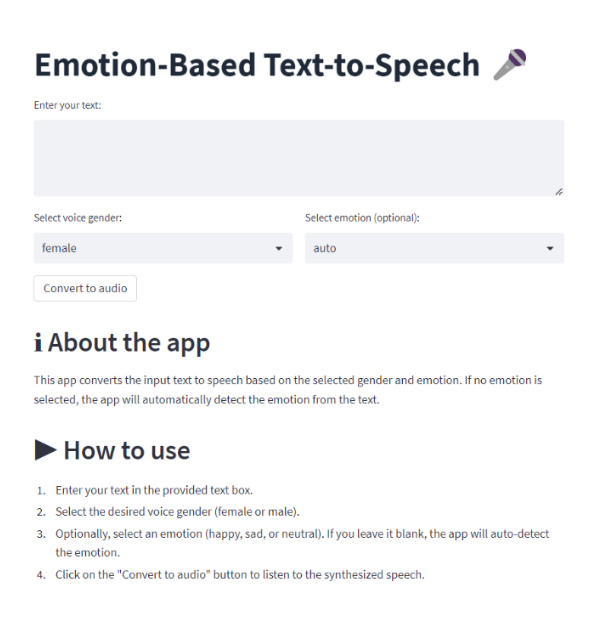
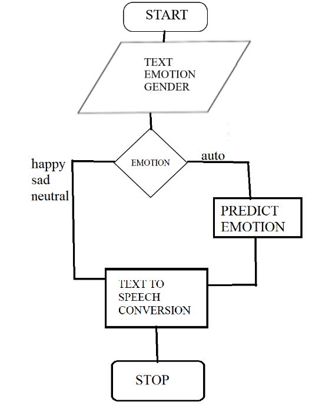
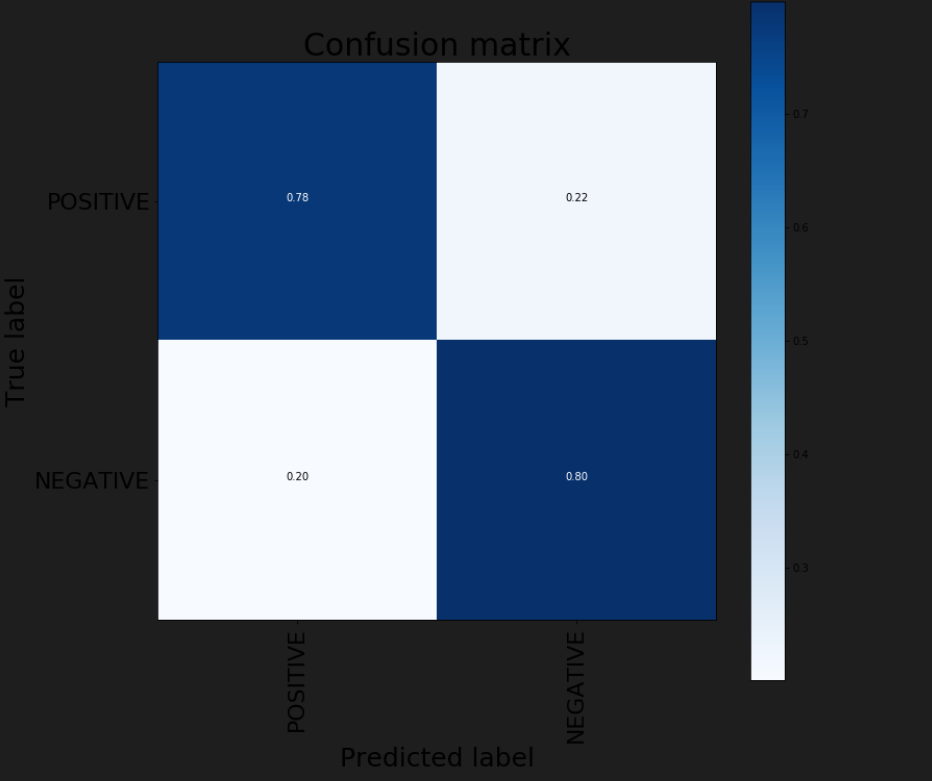
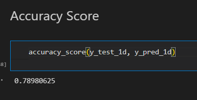
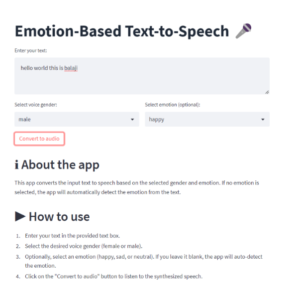
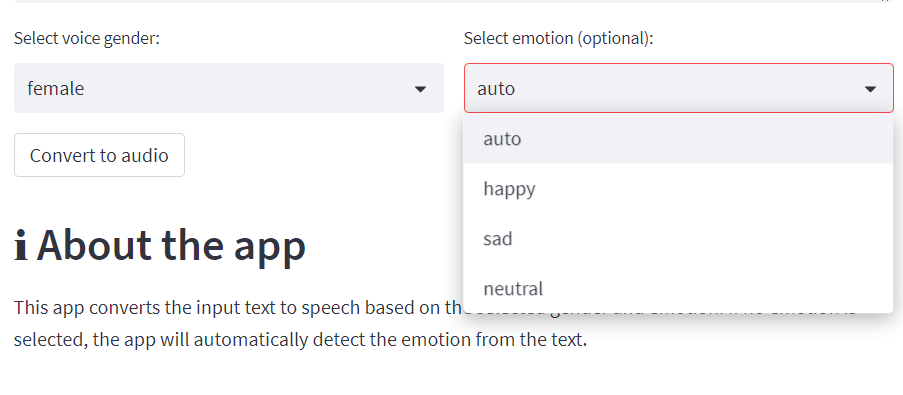

# Emotional Text-to-Speech Translator

A text-to-speech application that speaks with emotion. Users type a message, and the app reads it aloud in a happy, sad or neutral voice, either chosen by the user or detected automatically by an LSTM deep learning model.

   

<p align="center">
  
</p>

## Table of Contents

- [Overview](#overview)
- [Key Features](#key-features)
- [Applications](#applications)
- [System Workflow](#system-workflow)
- [Emotion Detection Model](#emotion-detection-model)
- [Results](#results)
- [Screenshots](#screenshots)
- [Installation and Usage](#installation-and-usage)
- [Project Structure](#project-structure)
- [Limitations and Future Work](#limitations-and-future-work)
- [Contributors](#contributors)

## Overview

Text-to-speech (TTS) technology converts written text into spoken words. For people who cannot speak, including deaf, non-verbal and speech-impaired individuals, it is an essential way to communicate.

Most TTS systems, however, speak in a single flat tone. A message such as "I got the job!" sounds exactly like "I lost my job.", and the emotion behind the words is lost.

This project adds emotion to synthesised speech. The application analyses the text, identifies whether it is happy, sad or neutral, and adjusts the voice accordingly, so the listener hears both the words and the feeling behind them.

Developed as a final-year B.Tech project in Computer Science and Engineering (2023).

## Key Features

- **Emotion-aware speech:** speaking rate and volume adapt to a happy, sad or neutral emotion.
- **Automatic emotion detection:** an LSTM model classifies the emotion of the text.
- **Manual emotion selection:** users can override the model and choose the emotion themselves.
- **Voice selection:** male and female voices.
- **Playback and download:** audio plays directly in the browser and can be downloaded for sharing.
- **Simple web interface:** built with Streamlit, requiring no technical knowledge to use.

## Applications

| Area | Use case |
| --- | --- |
| Assistive communication | Enables speech-impaired, deaf and non-verbal people to communicate in conversations, at work, in shops or at medical appointments, with the right emotional tone. |
| Visual impairment | Reads messages, articles and documents aloud in a natural, expressive voice. |
| Elderly users | Provides an easier alternative to reading small text on screens. |
| Education | Supports children and students with reading difficulties by letting them listen to text. |
| Storytelling and audiobooks | Narrates stories with a voice that follows the mood of each sentence. |
| Voice assistants and chatbots | Delivers responses that sound friendly or empathetic, depending on the context. |
| Public announcements | Produces clear, neutral announcements for airports, railway stations and public transport. |
| Customer service | Makes automated phone and chat responses sound more polite and empathetic. |

## System Workflow

<p align="center">
  
</p>

1. **Input:** the user enters text and selects a voice (male or female) and an emotion (happy, sad, neutral or auto).
2. **Emotion check:** if an emotion is selected, it is used directly. If "auto" is selected, the text is passed to the emotion detection model.
3. **Emotion detection:** the text is cleaned, converted into Word2Vec embeddings and classified by the LSTM model, which returns a score between 0 and 1.
4. **Emotion mapping:** the score is mapped to an emotion.
5. **Speech synthesis:** pyttsx3 generates the speech with emotion-specific voice settings.
6. **Output:** the audio is played in the browser and offered for download.

| Model score | Emotion | Speaking rate (words per minute) | Volume |
| --- | --- | --- | --- |
| 0.7 to 1.0 | Happy | 150 | 100% |
| 0.4 to 0.7 | Neutral | 120 | 90% |
| 0.0 to 0.4 | Sad | 90 | 60% |

## Emotion Detection Model

| Component | Details |
| --- | --- |
| Dataset | Sentiment140: tweets labelled as positive (happy) or negative (sad) |
| Data split | 80% training, 20% testing |
| Pre-processing | Lower-casing; removal of links, user mentions, special characters and stop words (NLTK) |
| Word embeddings | Word2Vec, 300 dimensions, trained on the dataset (gensim) |
| Architecture | Embedding layer → Dropout (0.5) → LSTM (100 units) → Dense layer with sigmoid activation |
| Training | 8 epochs, batch size 1024, Adam optimiser, binary cross-entropy loss |

An LSTM (Long Short-Term Memory) network processes a sentence word by word while retaining information about earlier words. This allows it to capture context, for example recognising that "not happy" expresses a negative emotion.

The model is trained on positive and negative examples. Text with a score between the two thresholds (0.4 and 0.7) is classified as neutral.

The model training approach is adapted from the Kaggle notebook [Twitter Sentiment Analysis](https://www.kaggle.com/code/paoloripamonti/twitter-sentiment-analysis) by Paolo Ripamonti.

## Results

The model achieves **79% accuracy** on the test set, with a precision and recall of 0.79 for both classes.

<p align="center">
  
  <br>
  
</p>

## Screenshots

**Entering text and selecting a voice and emotion**

<p align="center">
  
</p>

**Emotion options**

<p align="center">
  
</p>

## Installation and Usage

### Prerequisites

- Python 3.9 to 3.11
- Linux or Google Colab: install the eSpeak speech engine with `sudo apt-get install espeak`
- Windows and macOS include built-in speech voices

### Installation

```bash
git clone https://github.com/Navya1223/Emotional-Text-To-Speech-Translator.git
cd Emotional-Text-To-Speech-Translator
pip install -r requirements.txt
```

### Training the model

Download the Sentiment140 dataset and run `sentiment_modelling.ipynb`. The notebook creates the two files required by the application:

- `model.h5`: the trained LSTM model (approximately 350 MB, so it is not stored in this repository)
- `tokenizer.pkl`: the tokenizer that converts words into numbers

### Running the application

```bash
streamlit run app.py
```

The application then opens in your browser, usually at `http://localhost:8501` (this address works only on the computer where the app is running).

### Using the application

1. Enter the text in the text box.
2. Select a female or male voice.
3. Select an emotion, or keep "auto-detect" to let the model decide.
4. Click **Convert to audio** to listen, and download the audio if required.

## Project Structure

```
Emotional-Text-To-Speech-Translator/
├── app.py                      # Streamlit web application
├── emotion_voice.py            # Command-line version
├── sentiment_modelling.ipynb   # Model training and evaluation
├── voice_available.py          # Lists the voices installed on the system
├── encoder.pkl                 # Label encoder from training
├── requirements.txt            # Python dependencies
└── images/                     # Screenshots and diagrams
```

## Limitations and Future Work

**Limitations**

- Supports three emotions: happy, sad and neutral.
- Supports English only.
- pyttsx3 adjusts speaking rate and volume, but not pitch or tone.

**Future work**

- Extend the model to more emotions, such as anger, fear and surprise, using an emotion-labelled dataset.
- Integrate a neural TTS engine (for example, Coqui TTS) for more natural changes in pitch and tone.
- Add support for more languages, including Hindi and Telugu.
- Develop a mobile application for everyday use.
- Integrate the system into telephony, ATMs and video games.

## Contributors

- N. Navya Geethika

## Technologies

Python, TensorFlow/Keras, LSTM, Word2Vec (gensim), NLTK, scikit-learn, pandas, Streamlit, pyttsx3
